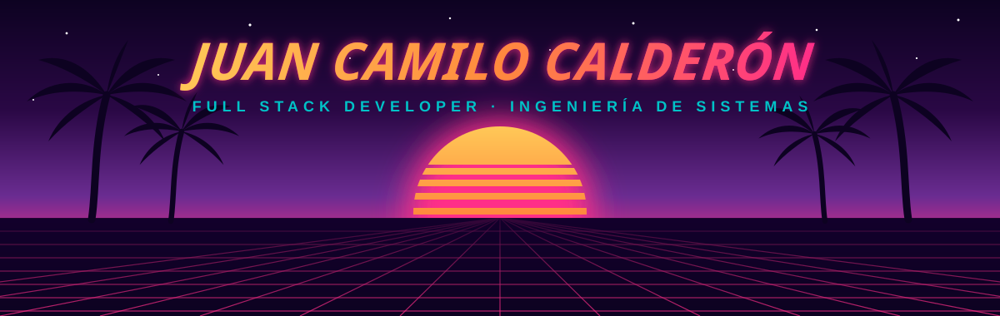

  <picture>
    <source media="(prefers-color-scheme: dark)" srcset="./assets/banner-dark.svg">
    <source media="(prefers-color-scheme: light)" srcset="./assets/banner-light.svg">
    
  </picture>

  

 

Hola, soy Juan Camilo. Voy en octavo semestre de Ingeniería de Sistemas en la Universidad Santo Tomás, en Tunja.

Ahora mismo estoy en full stack: casi siempre hago la interfaz, la API y la base de datos, y dejo el proyecto desplegado. También le meto algo de seguridad, nube e inteligencia artificial, y tengo bases de Big Data.

El año pasado ganamos una hackathon con mi equipo. Hicimos un sistema PQRSD para la empresa IdeaPro.

Español nativo, inglés B1.

   
   
  

[BLACKPINK Fansite](https://github.com/JuanK2550/BLACK-PINK-FANSITE) es el proyecto más completo que tengo. Es un sitio de fans no oficial en español, inglés y coreano, con discografía, integrantes, línea de tiempo, trivia, galería, quiz y PINKY, un chatbot que contesta preguntas sobre el sitio. El frontend está en Next.js y el backend son varios servicios en NestJS. [Verlo en vivo](https://blackpink-fansite.vercel.app).

Tengo otros más pequeños: la [prueba técnica](https://github.com/JuanK2550/prueba-tecnica-Juan-Camilo-Calderon-Delgado) que presenté (un CRUD con Node.js y Express), unos [laboratorios de PASETO](https://github.com/JuanK2550/lab-paseto-v1-v2-v3) y un [laboratorio de ciberseguridad](https://github.com/JuanK2550/Ciberseguridad-Colombia-Comparte). [Mi primera web](https://github.com/JuanK2550/mi-primera-web), en HTML y CSS, sigue publicada.

<picture>
  <source media="(prefers-color-scheme: dark)" srcset="https://github-readme-stats.vercel.app/api?username=JuanK2550&show_icons=true&include_all_commits=true&count_private=true&rank_icon=github&bg_color=0D0221&title_color=FF2E88&text_color=E8DDF5&icon_color=FFC857&ring_color=FF8A3D&border_color=3A1260&border_radius=10&custom_title=GitHub">
  
</picture>
<picture>
  <source media="(prefers-color-scheme: dark)" srcset="https://streak-stats.demolab.com?user=JuanK2550&locale=es&background=0D0221&border=3A1260&stroke=3A1260&ring=FF2E88&fire=FF8A3D&currStreakNum=FFC857&sideNums=FF2E88&currStreakLabel=E8DDF5&sideLabels=E8DDF5&dates=9C88BF&border_radius=10">
  
</picture>

<picture>
  <source media="(prefers-color-scheme: dark)" srcset="https://github-readme-activity-graph.vercel.app/graph?username=JuanK2550&bg_color=0D0221&color=E8DDF5&title_color=FF2E88&line=FF2E88&point=FFC857&area=true&area_color=6A2C91&hide_border=false&border_color=3A1260&radius=10&custom_title=%C3%9Altimos%2031%20d%C3%ADas">
  
</picture>

<picture>
  <source media="(prefers-color-scheme: dark)" srcset="https://raw.githubusercontent.com/JuanK2550/JuanK2550/output/snake-dark.svg">
  <source media="(prefers-color-scheme: light)" srcset="https://raw.githubusercontent.com/JuanK2550/JuanK2550/output/snake-light.svg">
  
</picture>

Si quieres hablar de un proyecto, escríbeme a [juancamilocalderondelgado9@gmail.com](mailto:juancamilocalderondelgado9@gmail.com).

